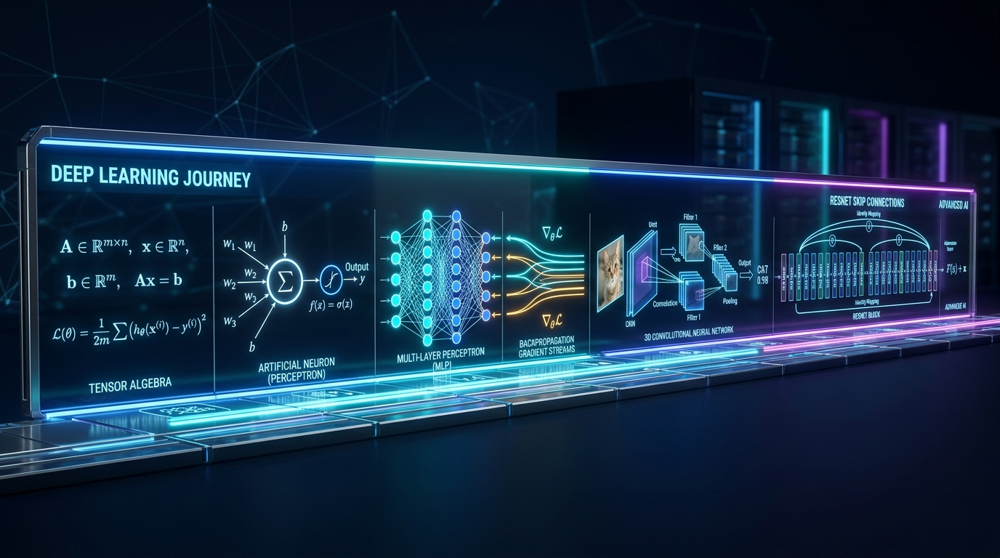

# 🚀 Deep Learning: Do 1 ao 8

[](https://pytorch.org/)
[](https://www.python.org/)
[](https://jupyter.org/)
[](https://colab.research.google.com/)
[](LICENSE)

Coleção completa e estruturada de **8 Laboratórios Práticos de Deep Learning** desenvolvidos em **Python e PyTorch**. Esta trilha aborda desde os alicerces matemáticos e os primeiros neurônios artificiais até o design, implementação e treinamento de arquiteturas modernas de **Visão Computacional e Redes Residuais (ResNet)**.

<p align="center">
  
</p>

---

## 🗺️ Matriz da Trilha de Aprendizagem

| Lab | Tema Principal | Conceitos-Chave e Algoritmos | Notebook |
| :---: | :--- | :--- | :---: |
| **01** | **Fundamentos Matemáticos** | Álgebra Linear, tensores, multiplicação de matrizes, derivadas parciais e vetor gradiente. | [Acessar Lab 01](notebooks/Lab_01_Fundamentos_Matematicos.ipynb) |
| **02** | **Neurônio Artificial e Perceptron** | Modelo McCulloch-Pitts, Perceptron de Rosenblatt, funções de ativação e separabilidade linear. | [Acessar Lab 02](notebooks/Lab_02_Neuronio_Artificial_e_Perceptron.ipynb) |
| **03** | **Redes Multicamadas (MLP) & Feedforward** | Camadas densas (`Linear`), não-linearidades (ReLU, Sigmoid, Softmax), forward pass em PyTorch. | [Acessar Lab 03](notebooks/Lab_03_MLP_Feedforward.ipynb) |
| **04** | **Backpropagation e Otimização** | Regra da cadeia, retropropagação de gradientes, SGD, Momentum, RMSprop e Adam. | [Acessar Lab 04](notebooks/Lab_04_Backpropagation_e_Otimizacao.ipynb) |
| **05** | **Regularização e Prevenção de Overfitting** | Trade-off viés-variância, Regularização L1/L2 (Weight Decay), Dropout e Early Stopping. | [Acessar Lab 05](notebooks/Lab_05_Regularizacao_e_Overfitting.ipynb) |
| **06** | **Métricas de Performance e Avaliação** | Matriz de confusão, Acurácia, Precisão, Recall, F1-Score, Curvas ROC e PR. | [Acessar Lab 06](notebooks/Lab_06_Metricas_de_Performance_e_Avaliacao.ipynb) |
| **07** | **Fundamentos de CNNs** | Convolução 2D, kernels, feature maps, padding, stride, Max/Avg Pooling e invariância espacial. | [Acessar Lab 07](notebooks/Lab_07_Fundamentos_de_CNNs.ipynb) |
| **08** | **CNNs e Visão Computacional Avançada** | Arquitetura LeNet-5, Skip Connections da ResNet ($H(x)=F(x)+x$), Projeção de Atalho e CIFAR-10. | [Acessar Lab 08](notebooks/Lab_08_CNNs_e_Visao_Computacional_Avancada.ipynb) |

---

## 🔬 Visão Geral dos Laboratórios

### 🔹 [Lab 01 — Fundamentos Matemáticos para Deep Learning](notebooks/Lab_01_Fundamentos_Matematicos.ipynb)
- Manipulação e transmissão de tensores multidimensionais com NumPy e PyTorch.
- Interpretação geométrica do produto escalar, transformações lineares e decomposições.
- Cálculo de gradientes e otimização por derivadas direcionais.

### 🔹 [Lab 02 — O Neurônio Artificial e o Perceptron](notebooks/Lab_02_Neuronio_Artificial_e_Perceptron.ipynb)
- Formulação matemática do neurônio biológico ao modelo computacional.
- Implementação orientada a objetos do algoritmo de aprendizado do Perceptron.
- Análise de convergência e resolução de portas lógicas lineares (AND, OR) e a limitação do XOR.

### 🔹 [Lab 03 — Redes Neurais Multicamadas (MLP) e Arquiteturas Feedforward](notebooks/Lab_03_MLP_Feedforward.ipynb)
- Superação da não-linearidade através de camadas ocultas e Teorema da Aproximação Universal.
- Estruturação modular com `torch.nn.Module`, `nn.Linear` e funções de ativação.
- Treinamento completo com funções de perda (`CrossEntropyLoss`, `MSELoss`).

### 🔹 [Lab 04 — O Algoritmo de Backpropagation e Otimização](notebooks/Lab_04_Backpropagation_e_Otimizacao.ipynb)
- Dedução analítica da regra da cadeia para redes profundas com múltiplos tensores de peso.
- Implementação manual do fluxo de gradiente computacional.
- Comparativo prático da taxa de convergência entre SGD, SGD com Momentum, RMSprop e Adam.

### 🔹 [Lab 05 — Regularização e Prevenção de Overfitting](notebooks/Lab_05_Regularizacao_e_Overfitting.ipynb)
- Diagnóstico do dilema viés-variância através de curvas de aprendizado (treino vs. validação).
- Mecânica e impacto do Dropout na co-adaptação de neurônios.
- Aplicação de penalidades de norma L1 (Lasso) e L2 (Ridge / Weight Decay).

### 🔹 [Lab 06 — Métricas de Performance e Avaliação do Aprendizado](notebooks/Lab_06_Metricas_de_Performance_e_Avaliacao.ipynb)
- Avaliação detalhada para cenários de classes balanceadas e desbalanceadas.
- Construção de matrizes de confusão e extração de Precisão, Recall e F1-Score ponderado.
- Análise da área sob a curva ROC (AUC-ROC) e limiares ótimos de decisão.

### 🔹 [Lab 07 — Fundamentos de CNNs](notebooks/Lab_07_Fundamentos_de_CNNs.ipynb)
- Transição de camadas densas para conectividade local e compartilhamento de pesos.
- Aplicação prática de filtros para extração de bordas, texturas e padrões espaciais.
- Mecanismos de subamostragem (Max Pooling e Average Pooling) e cálculo de campos receptivos.

### 🔹 [Lab 08 — CNNs e Visão Computacional Avançada](notebooks/Lab_08_CNNs_e_Visao_Computacional_Avancada.ipynb)
- **LeNet-5:** Cálculo analítico das dimensões espaciais $O = \lfloor\frac{I - K + 2P}{S}\rfloor + 1$ e validação prática.
- **ResNet:** Resolução do desvanecimento de gradientes via Skip Connections ($H(x) = F(x) + x \implies \frac{\partial L}{\partial x} = \frac{\partial L}{\partial H}(\frac{\partial F}{\partial x} + 1)$).
- **Projeção de Atalho:** Bloco residual com downsampling via convoluções $1 \times 1$ e BatchNorm.
- **Resultados:** Mini-ResNet no MNIST (**84.59%** acurácia) e ResNetCIFAR no CIFAR-10 (**74.55%** acurácia de teste).

---

## 📁 Estrutura do Repositório

```bash
├── notebooks/
│   ├── Lab_01_Fundamentos_Matematicos.ipynb
│   ├── Lab_02_Neuronio_Artificial_e_Perceptron.ipynb
│   ├── Lab_03_MLP_Feedforward.ipynb
│   ├── Lab_04_Backpropagation_e_Otimizacao.ipynb
│   ├── Lab_05_Regularizacao_e_Overfitting.ipynb
│   ├── Lab_06_Metricas_de_Performance_e_Avaliacao.ipynb
│   ├── Lab_07_Fundamentos_de_CNNs.ipynb
│   └── Lab_08_CNNs_e_Visao_Computacional_Avancada.ipynb
├── requirements.txt    # Dependências unificadas para todos os laboratórios
├── .gitignore          # Arquivos e diretórios ignorados pelo Git
├── LICENSE             # Licença MIT
└── README.md           # Guia completo da trilha
```

---

## 🚀 Como Executar

### 1. Clonar o repositório
```bash
git clone https://github.com/wjr007/Deep-Learning-1-ao-8.git
cd Deep-Learning-1-ao-8
```

### 2. Configurar o ambiente virtual
```bash
# Windows
python -m venv venv
.\venv\Scripts\activate

# Linux / macOS
python3 -m venv venv
source venv/bin/activate
```

### 3. Instalar dependências
```bash
pip install -r requirements.txt
```

### 4. Iniciar o Jupyter
```bash
jupyter lab
```
Ou abra qualquer notebook diretamente no **Google Colab**.

---

## 🛠️ Tecnologias Utilizadas

- **Linguagem:** Python 3.10+
- **Deep Learning Frameworks:** PyTorch, Torchvision
- **Computação Numérica & Dados:** NumPy, Pandas, Scikit-learn
- **Visualização de Dados:** Matplotlib, Seaborn
- **Ambientes:** Jupyter Notebook, Google Colab

---

## 👨‍💻 Autor

**Walteir Luiz de Morais Junior**

- 🐙 **GitHub:** [@wjr007](https://github.com/wjr007)
- 💼 **LinkedIn:** [walteir-junior](https://www.linkedin.com/in/walteir-junior/)

---

*Repositório educacional desenvolvido para fins de pesquisa, estudo prático e portfólio em Inteligência Artificial.*
